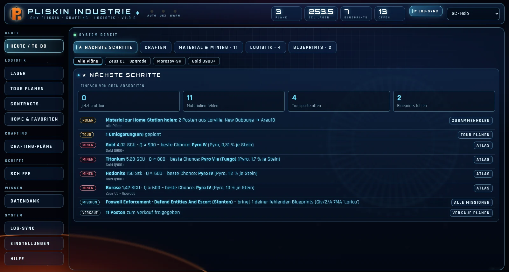
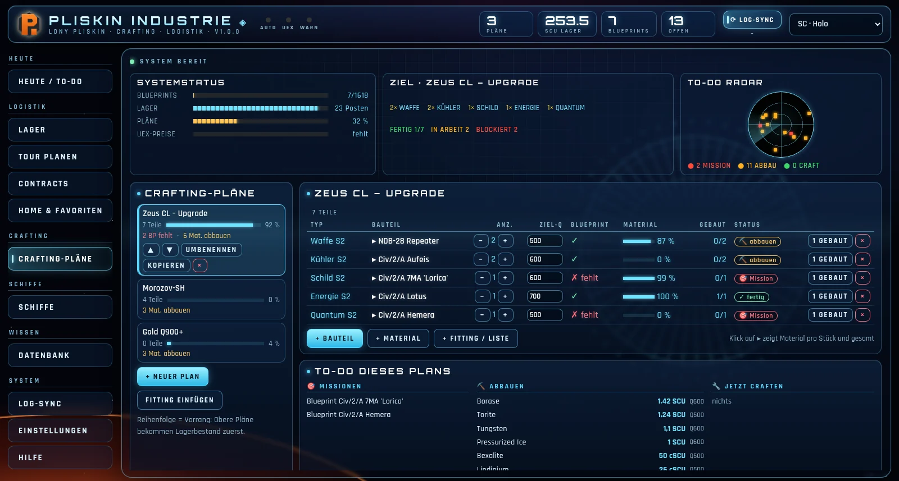
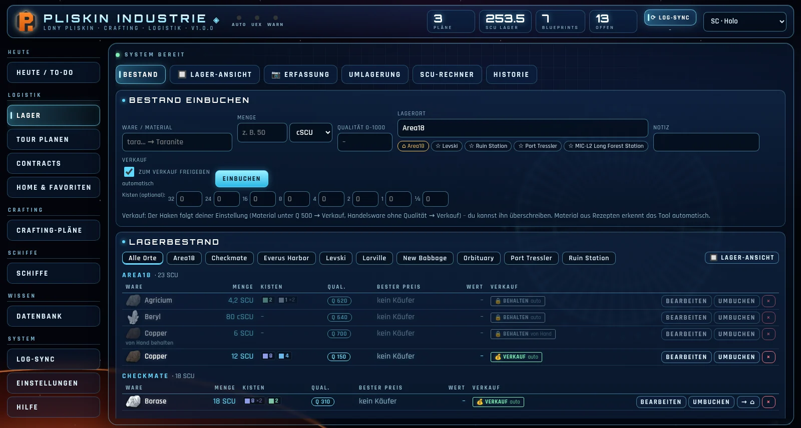
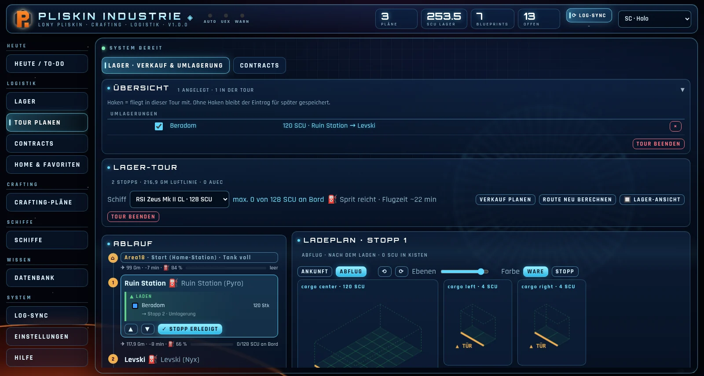
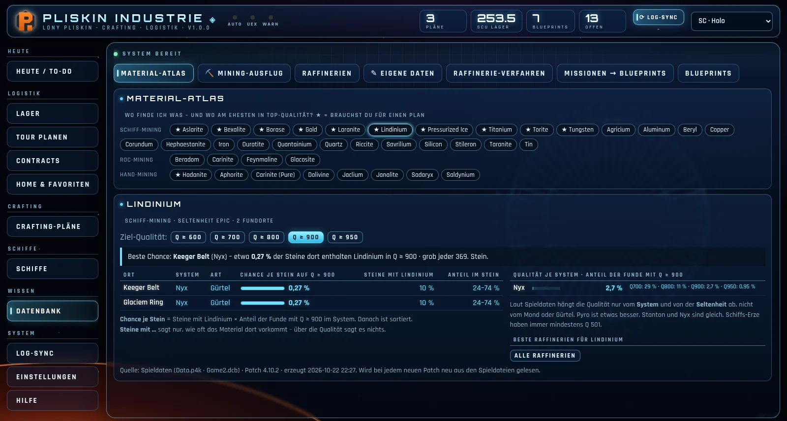
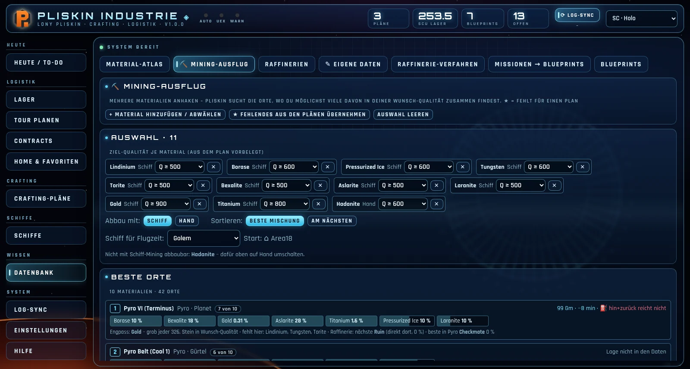
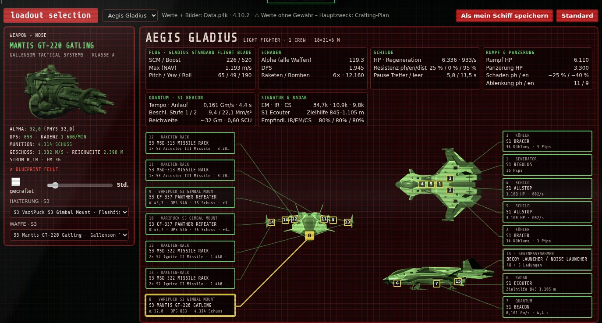
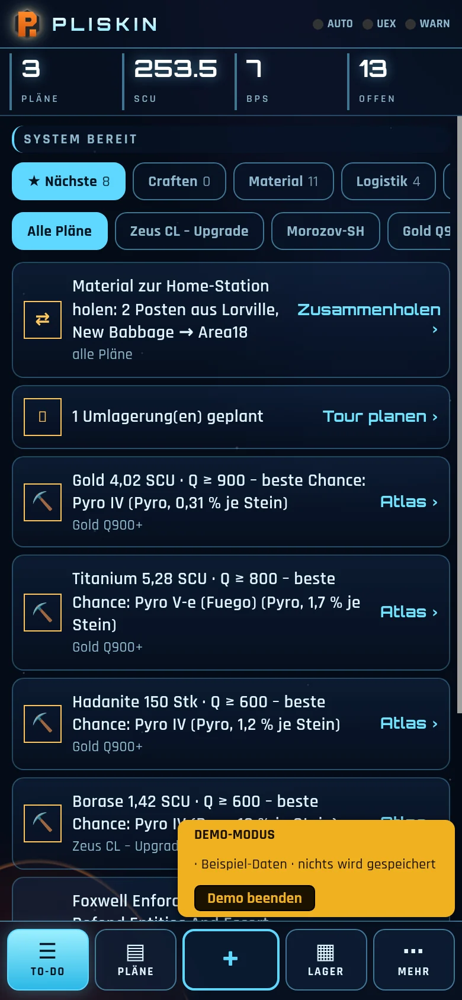
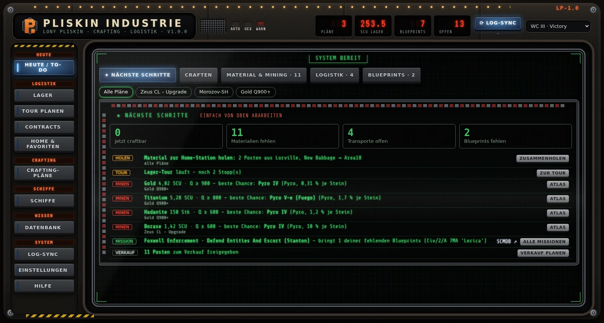
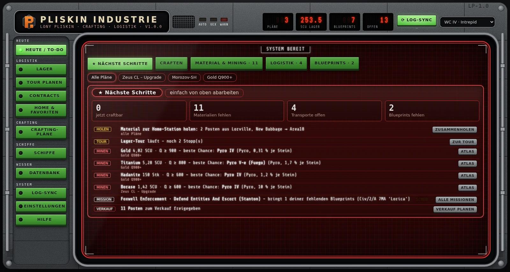

<h1 align="center">Pliskin Industrie 0.8.0</h1>

<b>Crafting · Lager · Logistik für Star Citizen</b> 
<a href="README.md">🇬🇧 English</a> · <a href="docs/HANDBUCH.md">Handbuch</a> · <a href="../../issues/new/choose">Fehler melden</a>

---

> **Version 0.8.0 – Vorab-Version.** Pliskin Industrie wird von **einer einzigen Person** in der Freizeit gebaut. Wie schnell neue Funktionen dazukommen und Fehler behoben werden, hängt von Zeit und Möglichkeiten ab – aber es wird laufend weiter daran gearbeitet. Rückmeldungen, Fehlerberichte und Screenshots sind sehr willkommen.
>
> Pliskin Industrie gibt es auf **Deutsch und Englisch** – die Sprache wählst du beim ersten Start oder unter Einstellungen → Programm.

Pliskin Industrie bringt **Blueprints, Crafting-Pläne, Lager, Mining und Fracht-Touren** an einen Ort. Das Programm liest deine Blueprints selbst aus dem Game.log, rechnet aus, was dir für deine Pläne noch fehlt und wo du es am besten findest. Die Spieldaten (Rezepte, Fundorte, Qualität, Schiffe, Karte) stammen direkt aus der `Data.p4k` des Spiels.

### Was es kann

| | |
|---|---|
| **Heute / To-do** – Was du jetzt craften kannst, was du holen oder minen musst und welche Mission dir einen fehlenden Blueprint bringt. Eine Liste zum Abarbeiten von oben nach unten. |  |
| **Crafting-Pläne** – Bauteile, ganze Rüstungs-Sets, Schiffs-Fittings (SPViewer-Cart einfügen) oder Material-Ziele. Ziel-Qualität wie im Spiel: Mischen = mengengewichteter Durchschnitt, das beste Material zuerst. |  |
| **Lager** – Bestand je Ort mit Qualität, Kisten und Einheiten (SCU bis µSCU). Material-Symbole wie im Spiel-Inventar. |  |
| **Lager-Ansicht** – dein Lager in 3D im Freight Elevator, mit echten SCU-Kisten aus den Spieldaten. Kiste auf einen anderen Ort ziehen = Umlagerung planen. |  |
| **Tour planen** – Verkaufs-, Umlager- und Contract-Touren mit kürzester Route, Hin- und Rückfracht, Ladeplan ohne Umladen, Karte, Flugzeit und Quantum-Sprit. |  |
| **Material-Atlas** – wo ein Rohstoff vorkommt und wo am ehesten in Top-Qualität („Chance je Stein“), dazu Raffinerien und Verfahren. |  |
| **Mining-Ausflug** – mehrere Materialien wählen, Pliskin sucht die Orte, an denen du möglichst viel davon zusammen bekommst, mit Entfernung von deiner Home-Station. |  |
| **Blueprint-Katalog** – alle Blueprints mit Werten bei Q0 / Q500 / Q1000, Skins, Sets und eigenen Bildern aus den Spielmodellen. Status: hab ich, fehlt, erspielbar. |  |
| **Schiffs-Fitting (neu, im Aufbau)** – Ausstattungs-Konfigurator im Stil der Wing-Commander-Loadout-Bildschirme: Waffen, Raketen-Racks und Raketen, Türme, Komponenten, Mining-Köpfe mit Modulen und Gadgets, Paints und Flight Blades, Strom-Pips, Kühlung, Radar, Signaturen. Getauschte Waffen erscheinen auf den Schiffsbildern. Mit einem Klick wird daraus ein **Crafting-Plan** – darum geht es vor allem. Bisher nur **Gladius, Golem und Polaris**; die Werte stammen aus den Spieldaten, sind aber teils vereinfacht oder geschätzt – **nicht jeder Wert stimmt zwingend mit dem Spiel überein**. |  |
| **StarStrings-Häkchen** – wer [StarStrings von MrKraken](https://github.com/MrKraken/StarStrings) nutzt, bekommt in den Blueprint-Listen der Missionsbeschreibungen Markierungen: **[X]** hab ich, **[Gesucht]** (fehlt und steckt in einem Plan, grün), **[Fehlt]**. Missionen mit gesuchtem Blueprint bekommen **[Gesucht]** im Titel. StarStrings muss vorher installiert sein; Pliskin ändert nur diese Datei und legt eine Sicherung an. | |
| **Schiffe** – Cargo-Grids von rund 100 Schiffen aus den Spieldaten, Tür-Seite, Quantum-Antrieb, Reichweite. |  |
| **Erfassung per Taste** (Standard **Pause**) – Kisten-Tooltip im Inventar/Freight Manager, Kiste im Traktorstrahl (Größe aus dem Gewicht) oder Blueprint im Fabrication Kiosk: Pliskin liest Material, Qualität, Menge bzw. den Blueprint-Namen und sammelt alles, bis du bestätigst. Auch vom Handy aus auslösbar. | |
| **Handy & Tablet** – eigene Oberfläche fürs Handy (Server-Modus, siehe unten). |  |

**7 Designs:** SC Holo, SC Item Fabricator, SC Freight Elevator sowie Wing Commander III Victory, WC IV Lexington, WC IV Intrepid und Prophecy Midway.

  

### Baustellen (bekannte Lücken)
- **Schiffs-Fitting:** bisher nur 3 Schiffe (Gladius, Golem, Polaris) – die übrigen kommen nach und nach (jedes Schiff braucht eigene Bilder). Noch nicht jeder Wert ist exakt (z. B. Wirkung gecrafteter Qualität auf manche Werte, Strom-/Kühlungs-Formeln sind geschätzt). Fürs Handy gibt es das Fitting noch nicht.
- **Bilderkennung:** Kisten-Tooltips, Traktorstrahl und Blueprints gehen; Raffinerie-Terminal und Shop-Preise fehlen noch.
- **Englisch:** in neueren Ansichten können noch einzelne deutsche Wörter stehen; das Handbuch gibt es vorerst nur auf Deutsch.
- **Contracts aus dem Game.log** und Live-Handelspreise sind geplant.
- Die Programmdateien sind noch nicht signiert (Windows-SmartScreen-Warnung).

### Herunterladen und starten
1. Unter **Releases** die Datei für dein System laden:
   - Windows: `Pliskin-Industrie-v0.8.0-windows.exe`
   - Linux: `Pliskin-Industrie-v0.8.0-linux-x86_64`
2. **Windows:** Doppelklick. Windows warnt evtl. („Der Computer wurde durch Windows geschützt“), weil das Programm nicht signiert ist → *Weitere Informationen* → *Trotzdem ausführen*. Die Datei lässt sich mit `SHA256SUMS.txt` aus dem Release prüfen.
   **Linux:** `chmod +x Pliskin-Industrie-*-linux-x86_64` und starten. Fehlen Fenster-Bausteine (Qt), öffnet Pliskin sich automatisch im Browser.
3. Beim ersten Start: Sprache (Deutsch/English), Design und **leer starten** oder **Demo ansehen** wählen.

Deine Daten liegen nur bei dir: Windows `%LOCALAPPDATA%\PliskinIndustrie`, Linux `~/.local/share/PliskinIndustrie` (mit täglicher Sicherung). Ins Internet geht nichts automatisch – Preise von UEX oder Fundorte von SCMDB holst du nur auf Knopfdruck.

### Server-Modus (Handy, Laptop)
Einstellungen → Programm → *Server-Modus*: Pliskin öffnet sich für dein Heimnetz. Handy oder Laptop öffnen die angezeigte Adresse (z. B. `http://192.168.0.10:8770`) im Browser und arbeiten mit denselben Daten. Nur fürs Heimnetz gedacht (kein Passwort).

### Erfassungs-Taste im Spiel
Läuft Star Citizen mit Administrator-Rechten, gibt Windows Tastendrücke nicht an normale Programme weiter. Dann Pliskin auch als Administrator starten (Einstellungen → Programm → „Als Administrator neu starten“) – oder die Erfassung vom Handy aus auslösen.

### Updates
Pliskin prüft beim Start, ob es eine neue Version gibt (abschaltbar). Unter Einstellungen → Programm lässt sich jede Version – auch eine ältere – installieren. Die bisherige Programmdatei bleibt als Sicherung daneben liegen, deine Daten bleiben unverändert.

### Hilfe und Fehler melden
- Im Programm: **Hilfe** (mit Rundgang und Demo-Modus) und **Hilfe → Kontakt & Fehler melden**.
- Ausführliches [Handbuch](docs/HANDBUCH.md).
- [Fehler melden oder Wunsch einreichen](../../issues/new/choose) – oder per Mail an **pliskinindustrie@gmail.com**.

### Aus dem Quelltext bauen
Python 3.12, dann `bauen/windows.bat` bzw. `bauen/linux.sh`. Ohne Bau starten: `pip install -r requirements-windows.txt` (bzw. `-linux`), dann `python hysec_industrie.py`.
Neue Version: `VERSION` in `hysec_industrie.py` erhöhen, Tag `v<Version>` pushen – GitHub baut beide Programme und hängt sie ans Release (`.github/workflows/release.yml`).

### Datenquellen und Dank
Spieldaten aus der `Data.p4k` (Patch steht im Programm unten). Optional auf Knopfdruck: UEX Corp (Handelspreise), SCMDB (Fundorte, Raffinerie-Boni). Blueprint-Listen in Missionen: [StarStrings von MrKraken](https://github.com/MrKraken/StarStrings) (optional, separat installieren). Shader- und Modell-Logik für die Katalog-Bilder nach dem Open-Source-Projekt [StarBreaker](https://github.com/diogotr7/StarBreaker) (MIT).

### Lizenz
Der Quellcode steht unter der **GNU AGPL-3.0** (siehe [LICENSE](LICENSE)): Du darfst ihn frei nutzen, ändern und weitergeben. Wer eine veränderte Fassung weitergibt **oder als Online-Dienst für andere betreibt**, muss den eigenen Quellcode ebenfalls unter AGPL-3.0 offenlegen.
Spieldaten, Modelle und daraus erzeugte Bilder gehören Cloud Imperium Games und fallen nicht unter diese Lizenz.

Pliskin Industrie ist ein Fan-Projekt und steht in keiner Verbindung zu Cloud Imperium Games. Star Citizen® ist eine Marke von Cloud Imperium Rights LLC.
