

<h1 align="center">Pliskin Industrie 0.8.1</h1>

<b>Crafting · Storage · Logistics for Star Citizen</b> 
<a href="README.de.md">🇩🇪 Deutsch</a> · <a href="docs/HANDBUCH.md">Manual (German)</a> · <a href="../../issues/new/choose">Report a bug</a> · <a href="../../releases">Download</a>

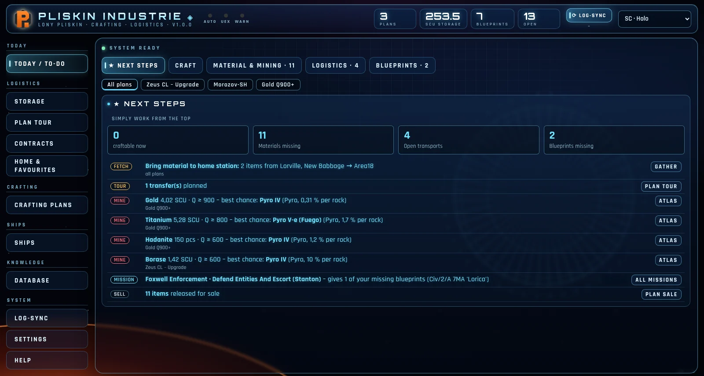

---

> **Version 0.8.1 – early access.** Pliskin Industrie is built by **one person** in their spare time. How fast features grow and bugs get fixed depends on time and resources – but work on it continues. Feedback, bug reports and screenshots are very welcome.
>
> The program is available in **English and German** – pick the language on first start or under Settings → Program.

Pliskin Industrie puts **blueprints, crafting plans, storage, mining and cargo tours** in one place. It reads your blueprints straight from the Game.log, works out what your plans are still missing and where to find it best. All game data (recipes, mining locations, quality, ships, map) comes directly from the game's `Data.p4k`.

### What it does

| | |
|---|---|
| **Today / To-do** – what you can craft right now, what you need to fetch or mine, and which mission rewards a missing blueprint. One list to work through from top to bottom. |  |
| **Crafting plans** – parts, whole armor sets, ship fittings (paste an SPViewer cart) or material goals. Target quality like in game: mixing = weighted average by amount, best material first. |  |
| **Storage** – stock per location with quality, crates and units (SCU down to µSCU). Material icons like the in-game inventory. | 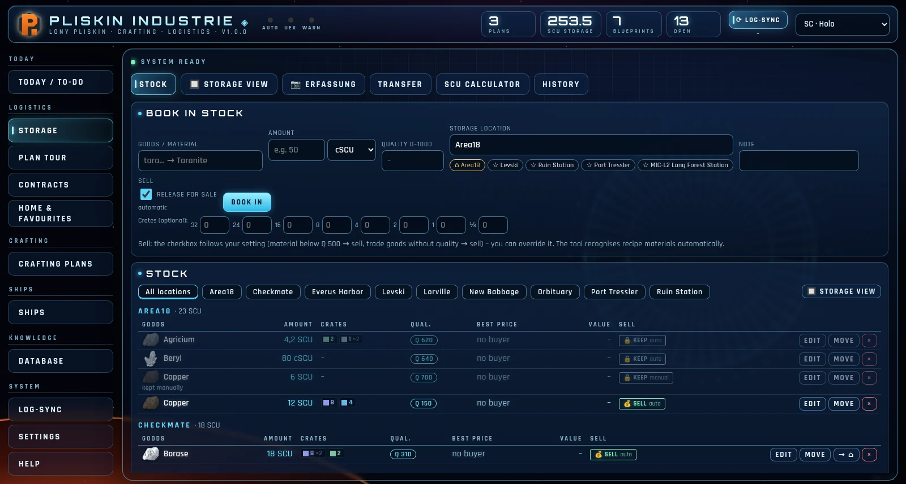 |
| **Storage view** – your storage in 3D inside the freight elevator, with real SCU crates from the game data. Drag a crate to another location to plan a transfer. | 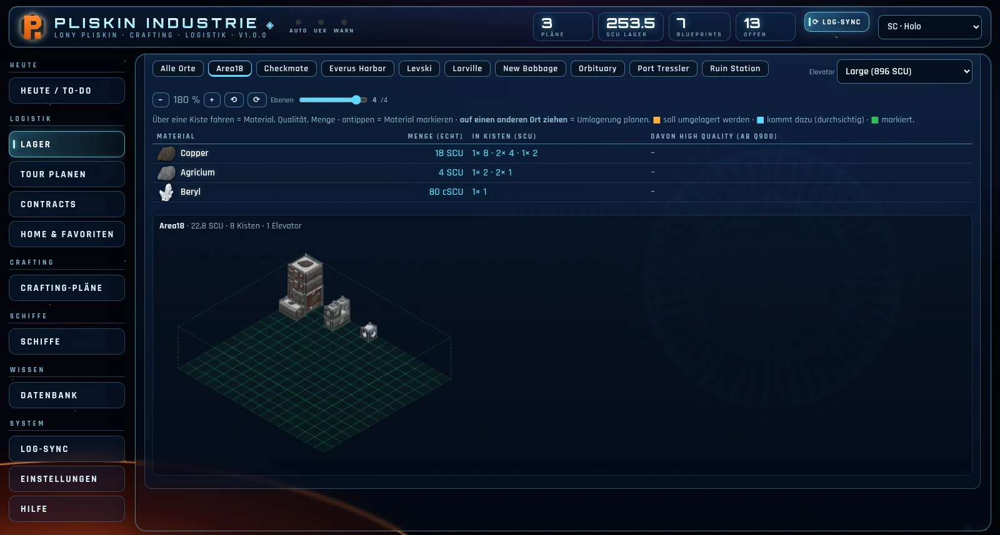 |
| **Tour planner** – sales, transfer and contract tours with the shortest route, round trips, a loading plan that never needs restacking, map, flight time and quantum fuel. | 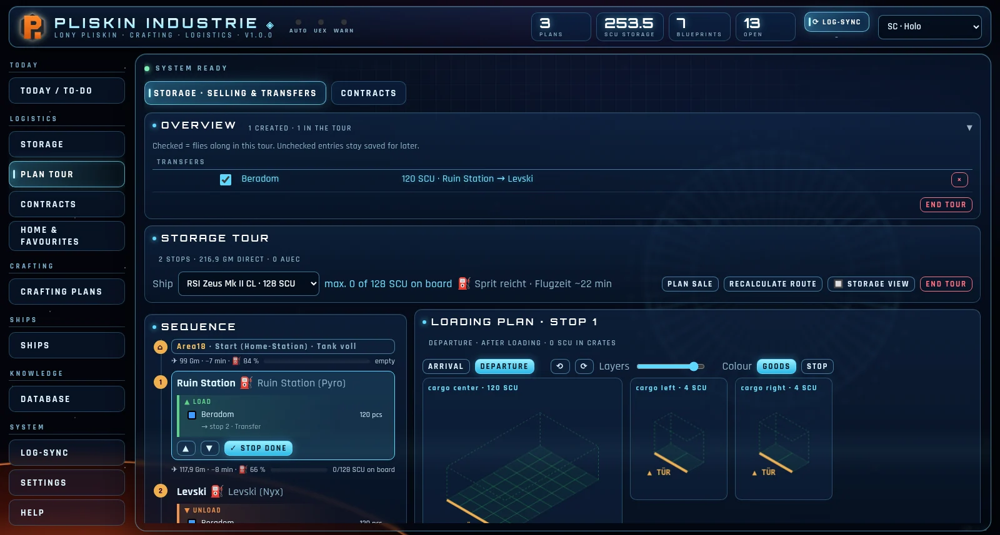 |
| **Material atlas** – where a resource spawns and where you are most likely to find top quality (“chance per rock”), plus refineries and methods. |  |
| **Mining trip** – pick several materials, Pliskin finds the places where you get most of them together, with distance from your home station. | 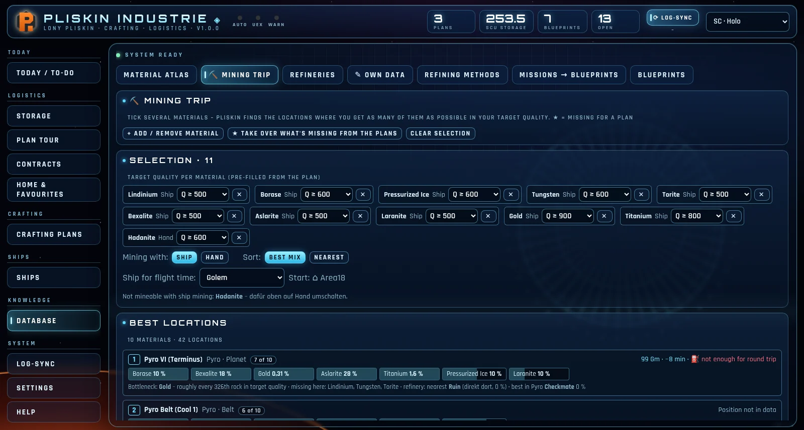 |
| **Blueprint catalog** – every blueprint with stats at Q0 / Q500 / Q1000, skins, sets and own renders from the game models. Status: owned, missing, obtainable. Mark blueprints as owned by hand. | 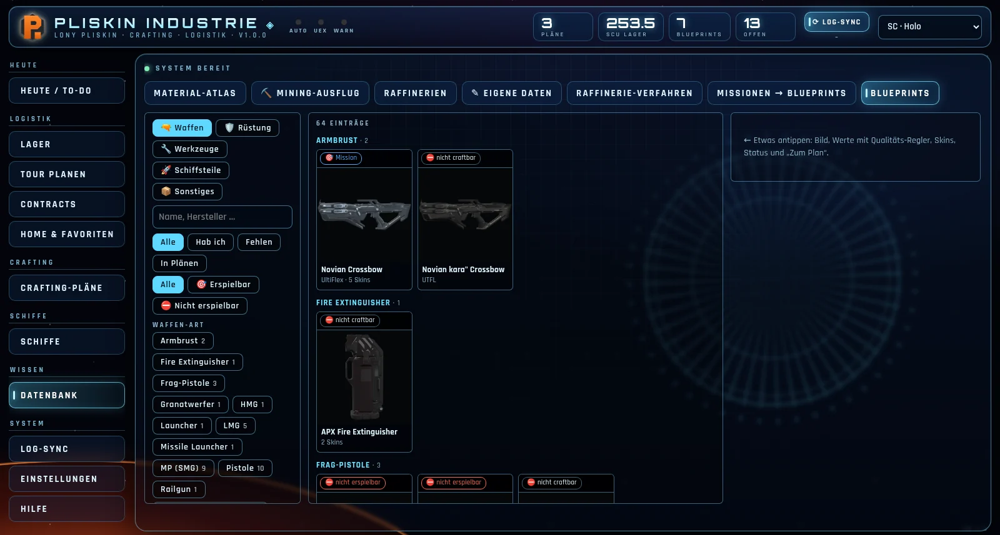 |
| **Ship fitting (new, work in progress)** – a loadout configurator in the style of the Wing Commander loadout screens: weapons, missile racks and missiles, turrets, components, mining heads with modules and gadgets, paints and flight blades, power pips, cooling, radar, signatures. Changed weapons show up on the ship renders. One click turns the loadout into a **crafting plan** – that is the main purpose. So far only **Gladius, Golem and Polaris**; values come from the game data but are partly simplified or estimated – **no guarantee that every number matches the game**. | 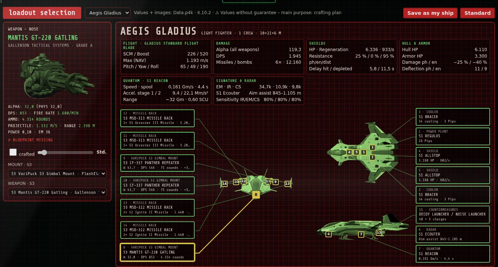 |
| **StarStrings blueprint marks** – if you use [MrKraken's StarStrings](https://github.com/MrKraken/StarStrings), Pliskin marks the blueprint lists in mission descriptions: **[X]** owned, **[Gesucht]** (wanted – missing and part of a plan, green), **[Fehlt]** missing. Missions with a wanted blueprint get **[Gesucht]** in the title. StarStrings must be installed first; Pliskin only changes that file and keeps a backup. | |
| **Ships** – cargo grids of about 100 ships from the game data, door side, quantum drive, range. | 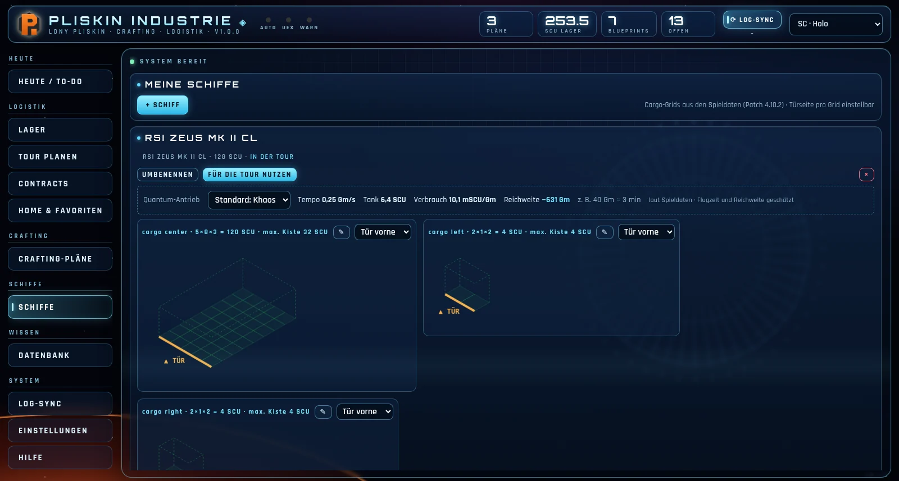 |
| **Capture by hotkey** (default **Pause**) – crate tooltip in the inventory/Freight Manager, a crate in the tractor beam (size from its weight) or a blueprint in the Fabrication Kiosk: Pliskin reads material, quality, amount or the blueprint name and collects everything until you confirm. Can also be triggered from your phone. | |
| **Phone & tablet** – a dedicated phone UI (server mode, see below). | 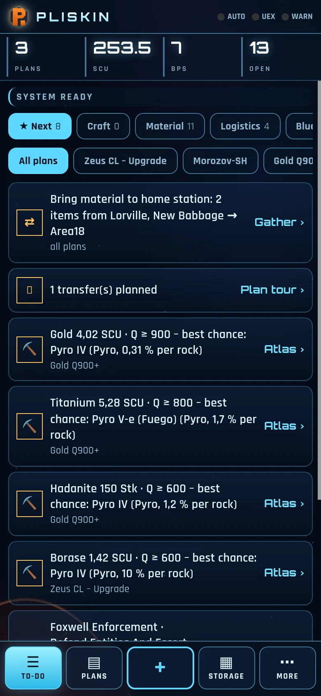 |

**7 designs:** SC Holo, SC Item Fabricator, SC Freight Elevator, plus Wing Commander III Victory, WC IV Lexington, WC IV Intrepid and Prophecy Midway.

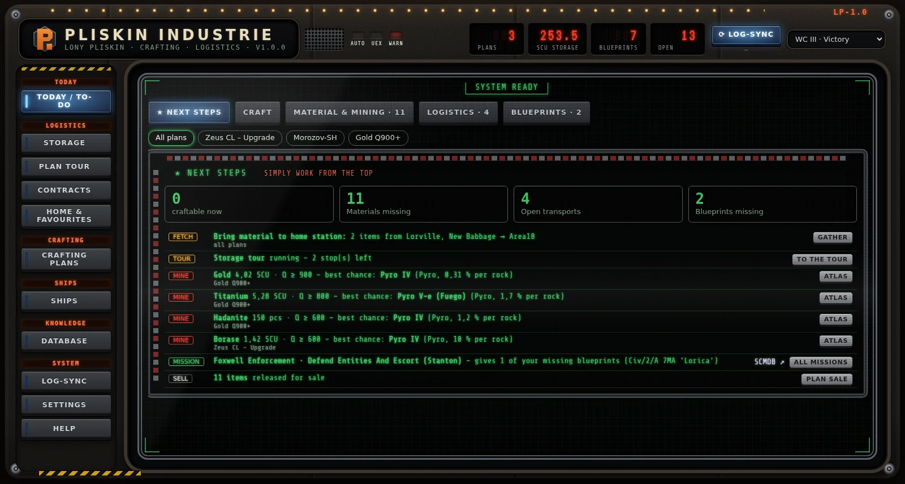  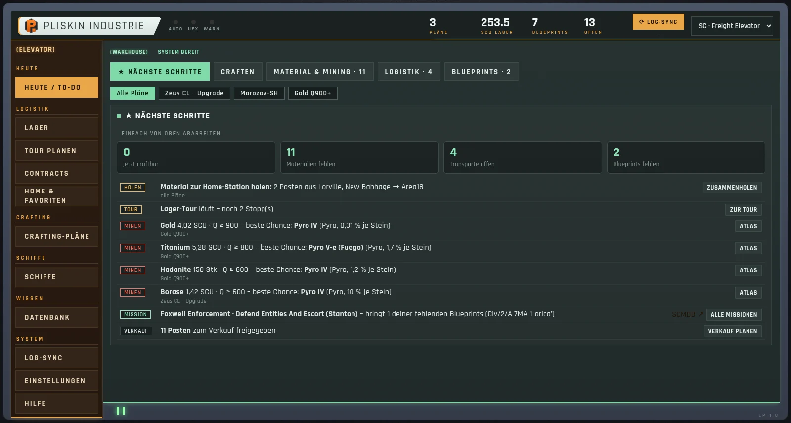

### Work in progress (known gaps)
- **Ship fitting:** only 3 ships so far (Gladius, Golem, Polaris) – the other ships follow step by step (every ship needs its own renders). Not every value is exact yet (e.g. effects of crafted quality on some stats, power/cooling formulas are estimates). Phone view of the fitting is still missing.
- **Image recognition:** crate tooltips, tractor beam and blueprints work; refinery terminal and shop prices are not done yet.
- **English:** newer screens may still contain a few German words; the manual is German only for now.
- **Contracts from the Game.log** and live trade prices are planned.
- Program files are not code-signed yet (Windows SmartScreen warning).

### Download and start
1. Get the file for your system under **[Releases](../../releases)**:
   - Windows: `Pliskin-Industrie-v0.8.1-windows.exe`
   - Linux: `Pliskin-Industrie-v0.8.1-linux-x86_64`
2. **Windows:** double-click. Windows may warn (“Windows protected your PC”) because the program is not signed → *More info* → *Run anyway*. You can verify the file with `SHA256SUMS.txt` from the release.
   **Linux:** `chmod +x Pliskin-Industrie-*-linux-x86_64` and run it. If window components (Qt) are missing, Pliskin opens in your browser instead.
3. On first start choose language (English/Deutsch), design and **start empty** or **try the demo**.

Your data stays on your machine: Windows `%LOCALAPPDATA%\PliskinIndustrie`, Linux `~/.local/share/PliskinIndustrie` (with daily backups). Nothing is fetched from the internet automatically – UEX prices or SCMDB data only when you press the button.

### Server mode (phone, laptop)
Settings → Program → *Server mode*: Pliskin opens up to your home network. Your phone or laptop opens the address shown (e.g. `http://192.168.0.10:8770`) in the browser and works with the same data. Home network only (no password).

### Capture key in game
If Star Citizen runs with administrator rights, Windows does not pass key presses to normal programs. Then start Pliskin as administrator too (Settings → Program → “Restart as administrator”) – or trigger the capture from your phone.

### Updates
Pliskin checks for a new version on start (can be muted). Under Settings → Program any version – including older ones – can be installed. The previous program file is kept next to it as a backup, your data stays untouched.

### Help and bug reports
- In the program: **Help** (with a guided tour and demo mode) and **Help → Contact & bug reports**.
- Detailed [manual](docs/HANDBUCH.md) (German for now).
- [Report a bug or request a feature](../../issues/new/choose) – or mail **pliskinindustrie@gmail.com**.

### Building from source
Python 3.12, then `bauen/windows.bat` or `bauen/linux.sh`. Run without building: `pip install -r requirements-windows.txt` (or `-linux`), then `python pliskin_industrie.py`.
New version: bump `VERSION` in `pliskin_industrie.py`, push tag `v<version>` – GitHub Actions builds both programs and attaches them to the release (`.github/workflows/release.yml`).

### Data sources and credits
Game data from the `Data.p4k` (patch shown at the bottom of the program). Optional, on button press: UEX Corp (trade prices), SCMDB (mining locations, refinery bonuses). Blueprint lists in missions: [StarStrings by MrKraken](https://github.com/MrKraken/StarStrings) (optional, installed separately). Shader and model logic for the catalog renders based on the open-source project [StarBreaker](https://github.com/diogotr7/StarBreaker) (MIT).

### License
The source code is licensed under the **GNU AGPL-3.0** (see [LICENSE](LICENSE)): you may use, change and share it freely. Anyone distributing a modified version **or running it as an online service for others** must publish their source code under AGPL-3.0 as well.
Game data, models and renders derived from them belong to Cloud Imperium Games and are not covered by this license.

Pliskin Industrie is a fan project and not affiliated with Cloud Imperium Games. Star Citizen® is a trademark of Cloud Imperium Rights LLC.
